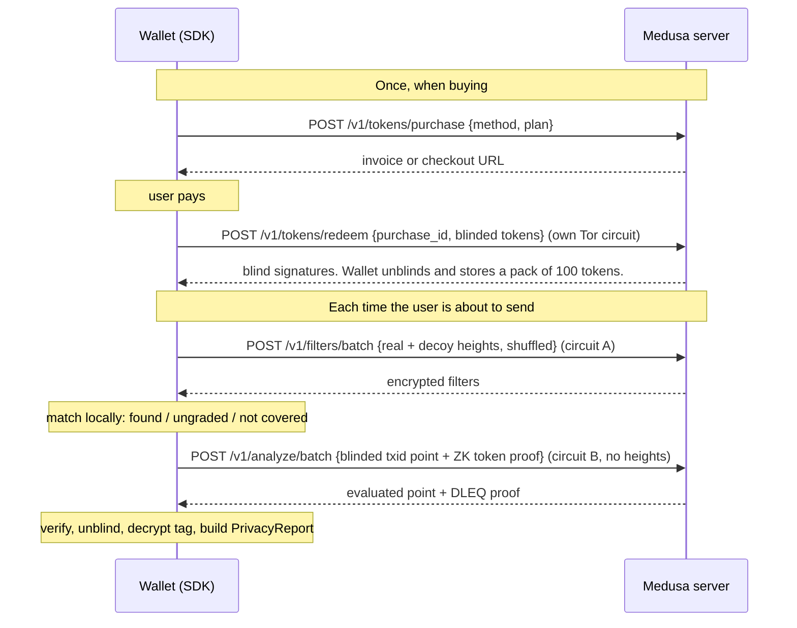

# 1. How it works

*Ten minutes. No cryptography background needed.*

## The problem

Before a user broadcasts a transaction, a wallet would like to warn them: *"this coin came from a transaction that reused an address, so spending it links your history."* The obvious design is to send the coin's txid to an analysis server and get an answer. But that tells the server exactly which coins the user owns, and that is the very leak we are warning about.

BTC Medusa gives the wallet the answer **without the server learning the question.** Here is how, one piece at a time.

## Piece 1: the analysis is done ahead of time

The server runs a privacy analysis engine (based on the open-source [am-i-exposed](https://github.com/Copexit/am-i-exposed)) over **every transaction in every block**. The result for each transaction is packed into a 24-bit **tag**: a handful of flags such as *address reuse*, *peel chain*, *CoinJoin*, *dust attack*, plus an overall grade from A–B down to F.

So the server never has to look at "your" transaction at query time. It already has an answer for everyone.

## Piece 2: one encrypted filter per block

For each block, the server publishes a **filter**: a compact list of that block's transactions, each with its tag in **encrypted** form.

- From a filter, the wallet can check whether its funding transaction is in that block (a Golomb-coded set; tens to hundreds of KB per block).
- It **cannot** read the tag yet. Each tag is encrypted under a key that only the server's secret key can help derive, and every transaction has a different key.

## Piece 3: decoys hide which block you care about

The wallet doesn't ask for just the block it cares about. It asks for that block **mixed with random decoy blocks**, shuffled, so the server sees a list of block heights such as `812345, 801992, 812301, …` and can't tell which is real. The decoys are drawn near the real height (a Laplace distribution), so they look plausible.

The wallet then matches its transaction **on the device**. Three things can happen:

| Result | Meaning | Cost |
|---|---|---|
| Found | The tag for this transaction is in the filter, still encrypted. | Go to piece 4. |
| **Ungraded** | The block has a filter, but this transaction was deliberately left out (dust, OP_RETURN-only, ordinals, runes and similar). This is not a privacy warning. | Free |
| **Not covered** | The server has no filter for that block yet. | Free |

## Piece 4: a blind question to the server

To decrypt a found tag, the wallet needs the server's secret key applied to its txid. That's done with an **OPRF** (oblivious pseudo-random function):

1. The wallet turns the txid into a point on an elliptic curve and multiplies it by a random number only the wallet knows. This is **blinding**, and the result looks like random noise.
2. The server multiplies that point by its secret key and sends it back, with a **DLEQ proof** that it used its real, published key. That stops a malicious server from giving different users different answers to fingerprint them.
3. The wallet removes its random number (**unblinding**). What's left is the txid evaluated under the server key: the decryption key for that tag.

The server performed the operation **without seeing the input**. It cannot tell which transaction it just helped decrypt.

## Piece 5: tokens pay for each blind question, anonymously

Each blind question costs one **token**. Tokens make the service sustainable, and they also stop someone from asking about every transaction in a block. But a normal account or API key would link all of a user's questions together. So tokens are built to be unlinkable:

- **Buying.** Tokens come in **packs** (normally 100). The wallet generates the tokens itself, blinds them, and the server signs them blind when the payment clears. The server knows a payment happened, but it never sees the tokens it signed.
- **Spending.** The wallet sends a **zero-knowledge proof** (Groth16) that says *"I hold a token the server signed, it hasn't expired, and its pack hasn't been revoked"* without revealing which token. Alongside it goes a **nullifier**, a value derived from the token that the server records so the same token can't be spent twice.

The server can see that *some* valid token was spent, but not which purchase it came from. (Spends from the same pack can currently be linked to each other, though not to what was checked; see [Privacy model](07-privacy-model.md#known-limitations).)

Packs are valid for a window of months (a single pack: this month and next). They can be **revoked**, for example after a card chargeback. Revocation is checked inside the zero-knowledge proof, against a public revocation tree.

## Piece 6: separate network paths

Even with all of the above, timing and IP addresses could link requests. So:
- Everything goes over **Tor**.
- The filter download and the token spend use **separate Tor circuits**, and the spend request carries **no block heights**. The server can't connect "this set of heights" to "this spend".
- Redeeming a purchase uses its own circuit too.

## The whole flow

In the SDK this is **two calls**: `redeem` for buying, and `analyzeInputs` for each check.

## What one analysis costs

One token per **distinct funding transaction** that is found. A transaction spending 5 coins that all came from the same earlier transaction costs 1 token; 5 coins from 5 different transactions cost up to 5. Ungraded and not-covered inputs cost nothing.

## Glossary

| Term | Meaning |
|---|---|
| **Tag** | 24-bit summary of a transaction's privacy analysis (format "v3-lean"). Turned into readable findings by the SDK. |
| **Codebook** | A public table mapping the small encrypted value in a filter to a 24-bit tag. Downloaded once. |
| **Filter** | Per-block encrypted list of transactions and their tags (format v5). |
| **Decoy** | A block height downloaded only to hide the real one. |
| **OPRF** | Oblivious pseudo-random function: the server computes a keyed function on an input it can't see. |
| **DLEQ proof** | Proof that the server used its published key, so it can't single out users. |
| **Token / pack** | A one-time credential for one OPRF evaluation; packs are bought in batches and stored on the device. |
| **Nullifier** | A value published when a token is spent, preventing double-spends without identifying the token. |
| **Groth16 proof / `pk.bin`** | The zero-knowledge proof attached to each spend. `pk.bin` is the proving key needed to create it, and it ships inside your app. |
| **Revocation tree** | Public list of revoked packs; spend proofs prove "not in this list". |
| **Epoch month** | `YYYYMM` used for pack validity. Taken from the server (`current_month`), which follows the blockchain's clock. |
